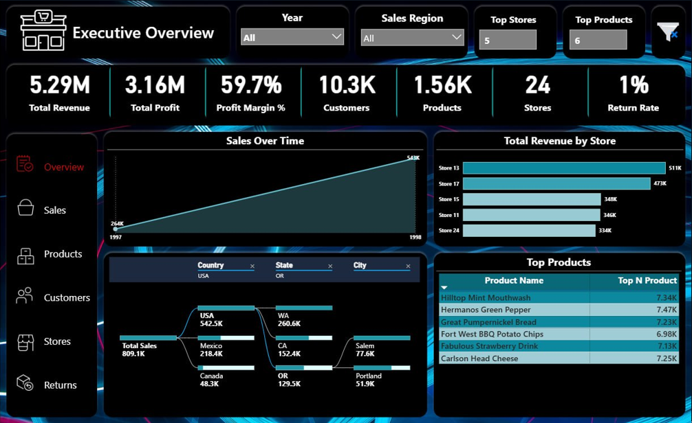
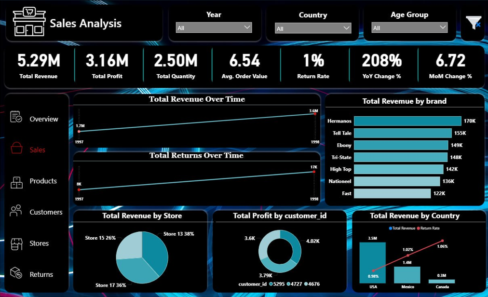
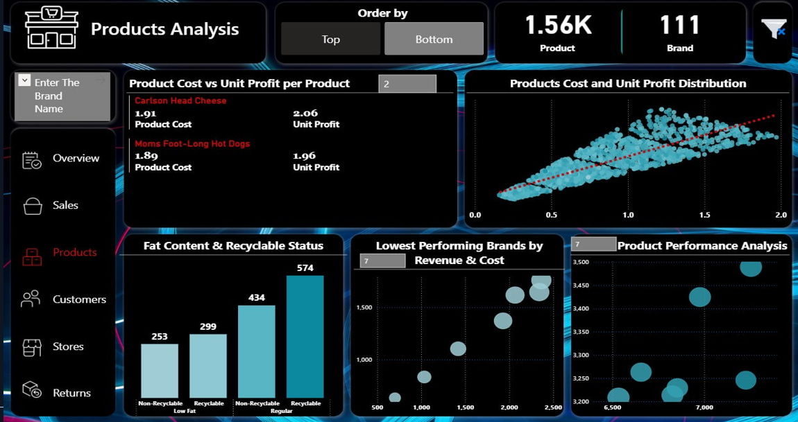
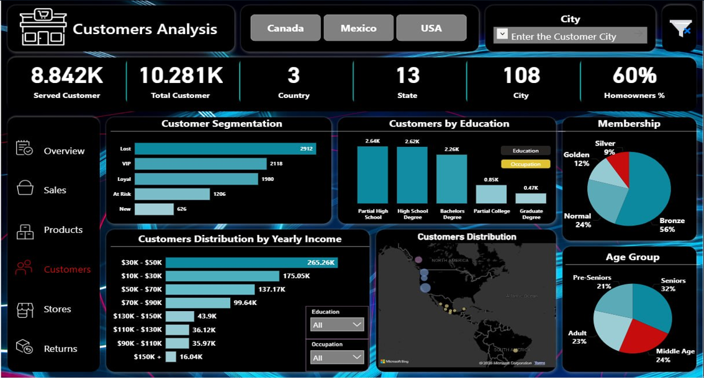
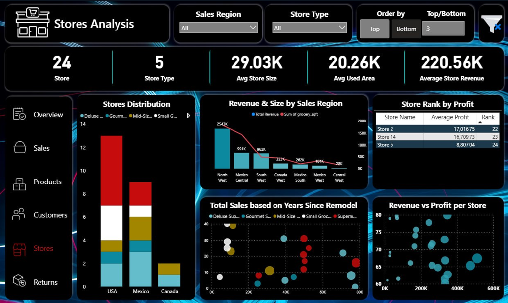
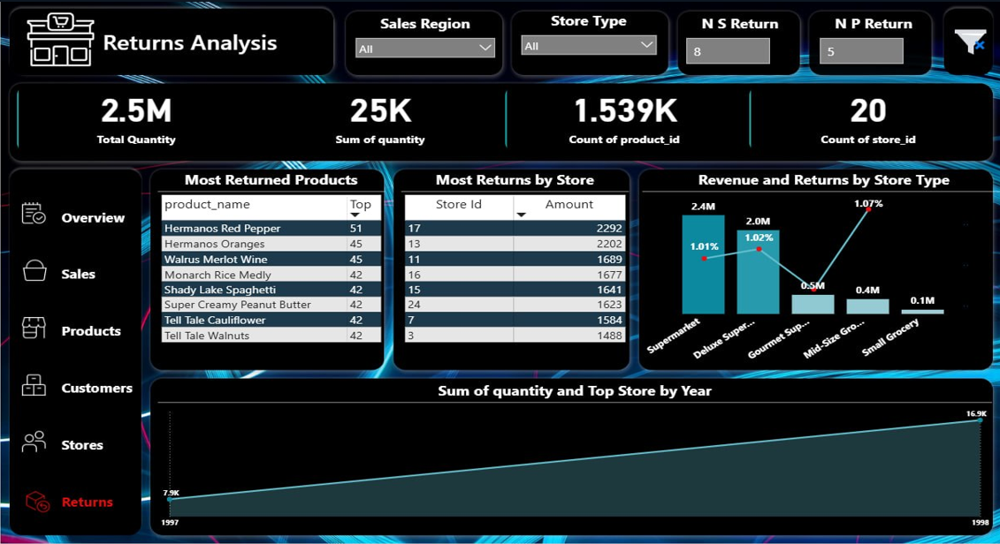

# Retail Sales & Operations Analytics | SQL Server + Power BI

End-to-end analytics capstone: raw retail data modeled and cleaned in **SQL Server**, then analyzed in an interactive multi-page **Power BI** report covering revenue, profit, returns, customer segmentation, and store performance across regions and store types.

## Project Workflow
1. **Load** – raw CSV/Excel sources loaded into a SQL Server database (`Retail_GP`) with primary/foreign keys.
2. **Validate** – row-count checks across all tables.
3. **Model** – star-schema style design: dimension tables (Calendar, Region, Stores, Products, Customers) and fact tables (Sales 2017/2018, Returns).
4. **Clean & Prepare** – SQL views that trim text, handle NULL/empty values, and add derived fields.
5. **Analyze** – 14 business questions answered in SQL (CTEs, window functions, ranking, RFM).
6. **Visualize** – Power BI report built on the cleaned views, with DAX measures and interactive navigation.

## SQL Highlights (`sql/Retail_DB.sql`)
- Database design with primary and foreign key relationships across 5 dimension and 3 fact tables
- Bulk loading and row-count validation
- Non-clustered indexes on the large sales tables to speed up joins and `UNION ALL`
- **14 business questions** answered with CTEs, window functions (`LAG`, `DENSE_RANK`, `ROW_NUMBER`, `NTILE`, running totals), and conditional logic, including:
  - Annual performance and growth
  - Top profitable brands and high-impact months
  - Store profitability and space efficiency
  - Gender and income-based purchasing behavior
  - Country performance and return impact
  - **RFM customer segmentation**
  - Top returned products
  - Product-type (low-fat / regular) analysis and a brand deep-dive
- **Cleaning views:** `vw_CleanCustomers`, `vw_CleanProducts`, `vw_CleanStores`, `vw_CleanCalendar`, `vw_CleanReturns`, and `vw_AllSalesFact`
- Derived fields: RFM segments, age groups, and numeric income midpoints for Power BI aggregations
- Stored procedure `sp_Run_PostLoad_Pipeline` to automate index creation after loading
- Reconciliation of Power BI measures against database totals

## Power BI Report (6 pages)
Dynamic Top/Bottom-N controls, Region / Year / Country slicers, and a navigation menu on every page.

### 1. Executive Overview
KPIs (revenue, profit, margin, customers, products, stores, return rate), sales over time, revenue by store, top products, and a decomposition tree (Country → State → City).



### 2. Sales Analysis
Revenue and returns over time, YoY and MoM change, revenue by brand, store, and country.



### 3. Products Analysis
Product cost vs. unit profit, cost/profit distribution (scatter), low-fat and recyclable breakdown, and lowest-performing brands.



### 4. Customers Analysis
Customer segmentation (VIP, Loyal, At Risk, New, Lost), education, income distribution, membership, age groups, and a geographic map.



### 5. Stores Analysis
Store distribution by type, revenue and size by region, store ranking by profit, years since remodel, and revenue vs. profit per store.



### 6. Returns Analysis
Most returned products, returns by store, revenue and return rate by store type, and returns trend.



## Project Presentation
The full capstone presentation (business problem, SQL data engineering, data modeling, cleaning challenges, dashboard walkthrough, insights, and recommendations) is available in [`presentation/Retail_Analysis_Final_Project.pdf`](presentation/Retail_Analysis_Final_Project.pdf).

**Key findings**
- Revenue grew 208% year-over-year (1997 to 1998), with the USA as the top country.
- Return rate stays around 1% of units sold, rising in step with sales.
- About 33% of customers are inactive, and Canada has the highest inactive rate.
- Store 13 is the benchmark store, contributing about 9.5% of total revenue.

**Recommendations:** remodel underperforming stores, expand in California, target senior customers, and replicate Store 13's practices.

## Team
Group capstone project by Nancy Khaled, Nureen Ehab, and Mahmoud Abo AlSaud.

## Tools
SQL Server (T-SQL), Power Query, Power BI Desktop, DAX

## Repository Structure
```
├── README.md
├── sql/
│   └── Retail_DB.sql        # schema, loading, cleaning views, business questions
├── screenshots/             # report page previews
├── presentation/
│   └── Retail_Analysis_Final_Project.pdf
└── Retail_Sales_Operations_Analytics.pbix
```

## How to Reproduce
1. Open `sql/Retail_DB.sql` in SQL Server Management Studio.
2. Update the file paths in the `BULK INSERT` statements to where your CSV files are located.
3. Run the script section by section: schema, load, validation, indexes, views, then the business questions.
4. Open the `.pbix` file in Power BI Desktop and point the data source to your SQL Server instance.

## Data
Sample retail dataset provided as part of the course capstone. Raw data files are not included in this repository.
